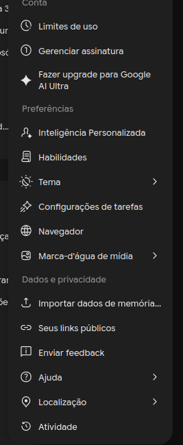
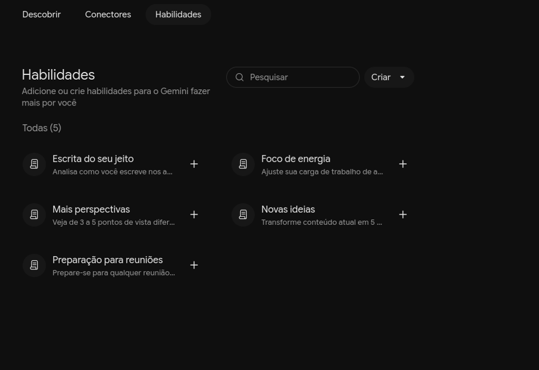
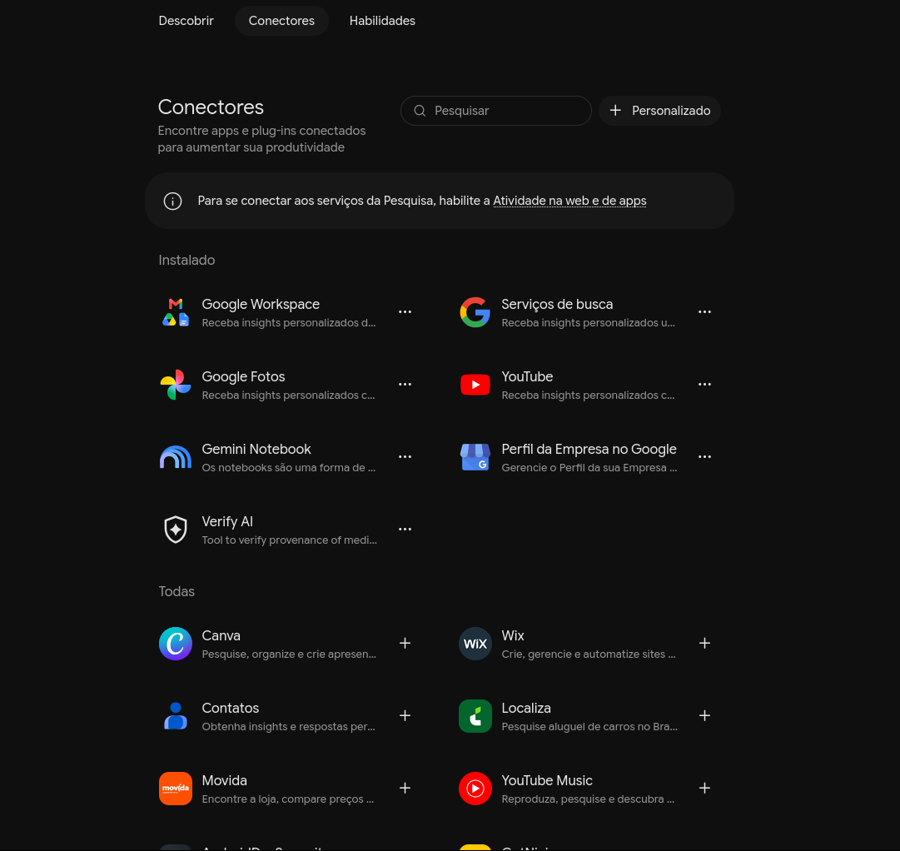
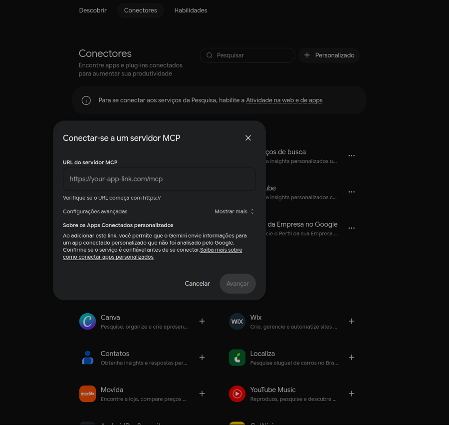

# Como ligar o Elden ao Gemini pelos conectores personalizados

**Em resumo:** O Gemini aceita conectores MCP personalizados, e é por essa porta que o Elden entra: você informa o endereço do servidor, confirma que confia no serviço e faz o login na tela de entrada do Elden. A conexão com o Gemini é recente e ainda está em teste, então o artigo também mostra o que fazer se ela não funcionar.

## O que você vai precisar

- Uma conta no Gemini. O passo a passo abaixo foi feito na versão web, em gemini.google.com.
- Uma conta no Elden, criada em https://elden.com.br/criar-conta (grátis, sem cartão). O login é feito na tela de entrada do Elden, com conta Google ou link enviado por e-mail. Não há senha.
- O endereço do conector: https://elden.com.br/mcp. Ele precisa começar com https://.
- Alguns minutos livres, porque a autorização acontece em duas etapas: primeiro no Gemini, depois na tela do Elden.

Antes de começar, um esclarecimento sobre o que muda na sua rotina: quem redige continua sendo a sua IA. O Elden passa a consultar leis e decisões dos tribunais brasileiros antes de responder, em vez de chutar, e oferece fontes e orientações de estilo. A leitura dos autos e a revisão final continuam com você. O Elden é um complemento com planos próprios, inclusive um gratuito; a assinatura da IA continua separada.

## Passo a passo

1. No Gemini (gemini.google.com), abra o menu de configurações e clique em "Habilidades". Há um atalho direto para essa tela: https://gemini.google.com/customize/connectors

2. Na tela "Habilidades" há três abas no alto: Descobrir, Conectores e Habilidades. Clique na aba "Conectores".

3. Na tela "Conectores", clique no botão "+ Personalizado", no canto superior direito, ao lado da busca.

4. Abre a janela "Conectar-se a um servidor MCP". No campo "URL do servidor MCP", cole https://elden.com.br/mcp. Não é preciso mexer nas "Configurações avançadas". Clique em "Avançar".

5. O Gemini avisa que o app conectado personalizado não foi analisado pelo Google e pede para você confirmar se o serviço é confiável. Esse aviso aparece para qualquer conector personalizado, não apenas para o Elden.

6. Em seguida, entre com a conta do Elden (Google ou link por e-mail) e autorize.

7. Na primeira pergunta jurídica, o aplicativo do Gemini pergunta se pode usar a ferramenta. O Elden tem apenas três ferramentas, justamente para pedir pouca permissão: Pesquisa jurídica e Contexto, ambas somente leitura, e Gravar, que é de escrita. Nas duas de leitura, dá para escolher "permitir sempre" (a redação varia conforme o aplicativo) e a pesquisa passa a rodar sem perguntar de novo. A de gravar convém manter perguntando.

8. Faça a primeira pergunta como falaria com um colega, citando o tribunal onde o processo corre, por exemplo "dano moral por extravio de bagagem, processo no TJCE". Também funciona colar um número de processo ou um artigo de lei. A IA consulta o Elden sozinha quando a pergunta é jurídica; você só pergunta como sempre.

Os nomes dos menus podem variar conforme a versão do aplicativo.

## Se algo não funcionar

A conexão com o Gemini é recente e ainda está em teste. Se der erro, o Claude é o caminho mais seguro: em Conectores, adicione https://elden.com.br/mcp e clique em "Entrar". No Claude, funciona em qualquer plano, inclusive no grátis. Quem usa o Claude Code pode ligar com o comando `claude mcp add --transport http elden https://elden.com.br/mcp`.

No ChatGPT, por enquanto, a OpenAI só deixa ligar ferramentas de fora nas contas Business, Enterprise e Edu; nas contas pessoais ainda não dá. E qualquer outra IA que aceite conectores MCP também serve, com configuração que varia conforme o aplicativo e o plano. A disponibilidade pode variar conforme o plano e a versão do aplicativo.

Sobre a pesquisa em si, a orientação do Elden é usar consultas curtas, com 5 a 8 palavras do vocabulário da ementa, como "cartão consignado RMC menor incapaz nulidade", que funcionam melhor que frases longas. Se vierem poucas decisões, refaça com menos palavras. E lembre-se: resultado vazio não prova ausência de precedente.

Por fim, os limites do que você recebe. O Elden localiza e mostra o que o documento diz; não aprova nem reprova teses. A ementa não é o inteiro teor, e a leitura do inteiro teor da decisão (o voto) está disponível nos planos pagos. Sempre confira no tribunal antes de citar.

## Próximo passo

Se quiser testar o conector no Gemini agora, crie sua conta no Elden e volte ao passo 1 desta lista. A partir daí, é só perguntar como já perguntaria à sua IA. [Criar conta grátis](https://elden.com.br/criar-conta)

---
Publicado também em https://elden.com.br/blog/como-conectar-o-elden-ao-gemini/
